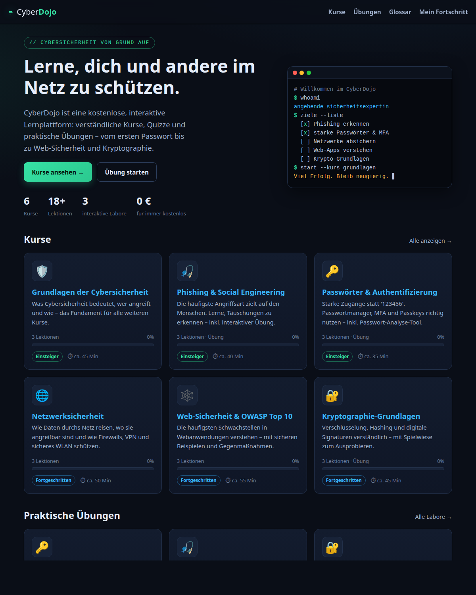

# 🛡️ CyberDojo – Cybersicherheit lernen

Eine **kostenlose, interaktive Lernplattform für Cybersicherheit** – komplett im Browser,
ohne Konto, ohne Tracking, ohne Build-Tooling. Reines HTML/CSS/JavaScript (keine Abhängigkeiten),
sofort als statische Seite deploybar (z. B. GitHub Pages).

👉 **Live:** https://adminarlnick.github.io/cyberdojo/



## Features

- **6 Kurse** mit insgesamt 18 Lektionen – von Einsteiger bis Fortgeschritten:
  1. Grundlagen der Cybersicherheit
  2. Phishing & Social Engineering
  3. Passwörter & Authentifizierung
  4. Netzwerksicherheit
  5. Web-Sicherheit & OWASP Top 10
  6. Kryptographie-Grundlagen
- **Abschluss-Quiz** je Kurs mit Auswertung und Erklärungen (bestanden ab 60 %).
- **3 interaktive Labore** (laufen lokal, nichts wird gesendet):
  - 🔑 Passwort-Stärke-Analyzer (Entropie + Knackzeit-Schätzung)
  - 🎣 Phishing-Erkennungs-Training (echt vs. Betrug, mit Auflösung)
  - 🔐 Krypto-Labor (Caesar, XOR, Live-SHA-256)
- **Fortschritt & Zertifikate** – lokal im Browser (localStorage), Zertifikat als PDF druckbar.
- **Dashboard**, **Glossar**, responsive, dunkles Design.

## Lokal starten

Einfach `index.html` öffnen – oder für saubere Routen einen kleinen Server:

```bash
python3 -m http.server 8080
# dann http://localhost:8080 im Browser öffnen
```

## Aufbau

```
index.html          Seitengerüst
css/styles.css      Design (dunkles Theme)
js/courses.js       Kurs-/Lektions-/Quiz-Inhalte (reine Daten)
js/labs.js          interaktive Übungen
js/app.js           Router, Rendering, Fortschritt
```

Neue Kurse oder Lektionen fügt man einfach als Objekt in `js/courses.js` hinzu – kein Build nötig.

## Hinweis

CyberDojo dient **ausschließlich Bildungs- und Verteidigungszwecken**. Wende Techniken nur auf
**eigenen Systemen oder mit ausdrücklicher Erlaubnis** an. In Deutschland ist unbefugtes Ausspähen/
Abfangen von Daten strafbar (§§ 202a ff. StGB). Die Inhalte orientieren sich an BSI/OWASP/NIST,
ersetzen aber keine Rechts- oder Sicherheitsberatung.

## Lizenz

MIT – siehe [LICENSE](LICENSE).
